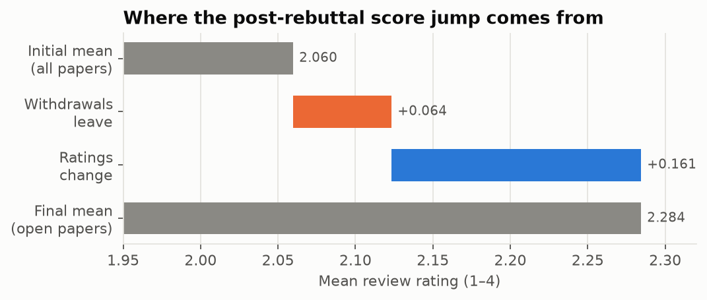
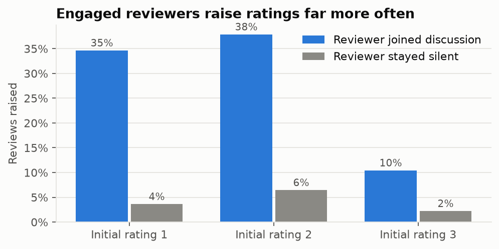
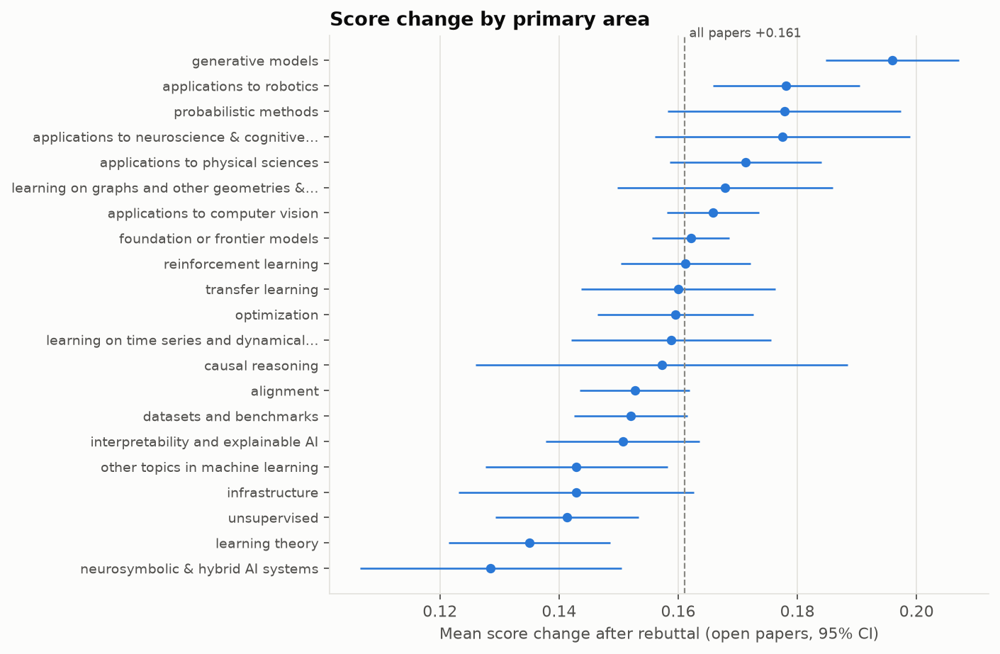
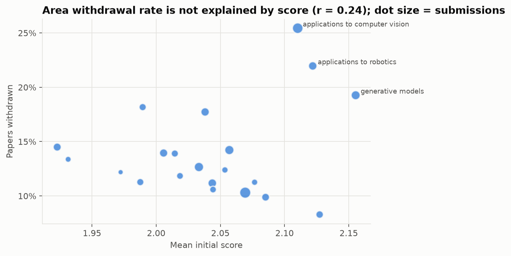
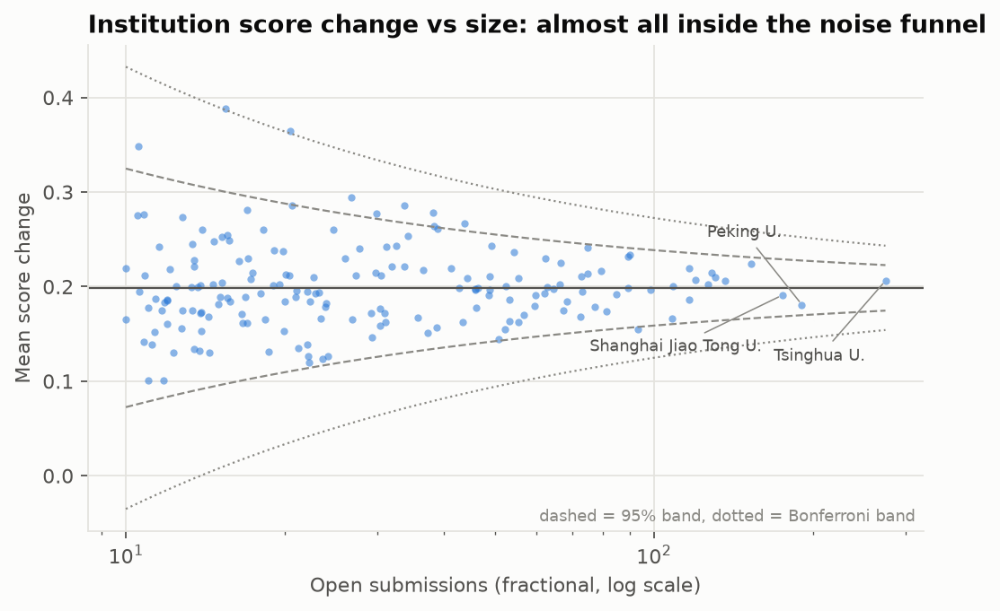
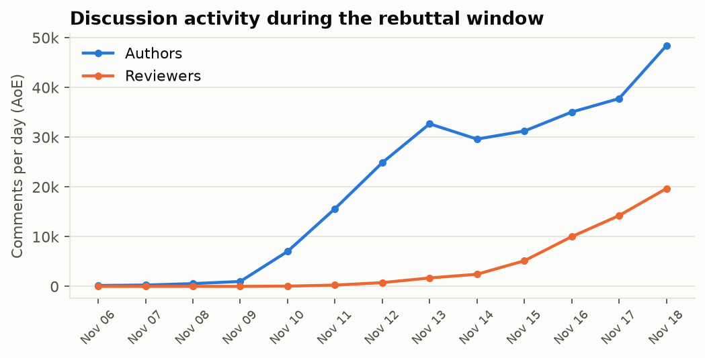

# ICLR 2027 results posters + my analysis

This repo is a copy of [clareLab/posters](https://github.com/clareLab/posters) (MIT license, kept in [LICENSE](LICENSE)).
The ICLR 2027 posters, their data pipelines and the summary tables are clareLab's work. On top of that I added my own
analysis of the rebuttal phase in [`analysis/`](analysis/).

- [clareLab's ICLR 2027 posters](#clarelabs-iclr-2027-posters)
- [My analysis of the rebuttal phase](#my-analysis-of-the-rebuttal-phase)
- [Repo layout](#repo-layout)
- [Running things](#running-things)

## clareLab's ICLR 2027 posters

All three are built from OpenReview (reviews) and OpenAlex (author affiliations). ICLR 2027 reviews use a 1–4 rating scale.

### Review scores ([`iclr2027-scores/`](iclr2027-scores/))

- **40,544** submissions under review with **125,304** reviews.
- Mean of per-paper average ratings: **2.06**; median **2.0**.
- Ratings given: 1 → 23,782 · 2 → 72,006 · 3 → 27,624 · 4 → 1,892. Almost 3 in 5 reviews were a 2.
- Only **37.9%** of papers average above 2.33, **15.1%** above 2.67 and **4.1%** at 3.0 or more.
- By primary area, average scores range from **1.92** (interpretability) to **2.16** (generative models).


### Institutions ([`iclr2027-institutions/`](iclr2027-institutions/))

Covers the 10,520 papers that could be matched to a preprint posted before reviews were released. Each paper is split fractionally across
its authors and their affiliations: **74 countries** and **1,884 institutions**. These papers score higher than the rest
(2.19 vs 2.02), so they are not a random sample.

- **China (33.4%)** and the **United States (32.0%)** account for two thirds of the matched submissions, then
  South Korea, Hong Kong, the UK, Germany and Singapore (3–4% each).
- Largest institutions: Tsinghua (3.0%), Peking (2.1%), Shanghai Jiao Tong (2.0%), Zhejiang (1.7%), Stanford (1.4%), NUS (1.4%).
- Among the top countries, South Korea (2.26) and Germany (2.23) have the highest average initial score; China and the US are both about 2.18.
- Universities supply 83% of the matched submissions; companies 10%, and company papers score a little higher (2.23 vs 2.18).


### Rebuttal ([`iclr2027-rebuttal/`](iclr2027-rebuttal/))

Compares a snapshot taken when reviews came out (2026-11-06) with one taken after the discussion period (2026-11-19).

- **6,127** papers (15.1%) were withdrawn and **16** were desk rejected; **34,400** stayed open.
- **17,373** reviews were raised and only **792** lowered; **13,791** open papers changed their average score.
- **75.5%** of open papers had an author response; authors posted **265,321** comments, reviewers **54,690**.
- Median score went from **2.0** to **2.33**.


## My analysis of the rebuttal phase

[`analysis/rebuttal_analysis.py`](analysis/rebuttal_analysis.py) works only from the summary tables in `iclr2027-rebuttal/`,
so it runs without the raw OpenReview data. All findings are in [`analysis/findings.md`](analysis/findings.md). The main ones:

1. **About 28% of the post-rebuttal score jump comes from withdrawals.** The mean went from 2.060 to 2.284 (+0.225). Withdrawn papers averaged 1.70,
   so dropping them accounts for +0.064; reviewers actually changing ratings accounts for +0.161.

   

2. **Reviewers who joined the discussion raised their rating about 6× as often** (29% vs 5%), at every starting rating.
   Harsher reviewers took part less: 24% of reviewers who gave a 1 joined the discussion, against 46% of those who gave a 3. This is a correlation, not proof of cause.

   

3. **The rebuttal effect really differs by area**: from +0.13 (neurosymbolic & hybrid AI) to +0.20 (generative models), far beyond
   what chance would produce (p ≈ 2e-13).

   

4. **An area's withdrawal rate doesn't follow its scores.** Computer vision (25%), robotics (22%) and generative models (19%) withdrew the most,
   yet score above average. One untested guess: papers leaving to resubmit to another conference.

   

5. **Every country got about the same boost** (+0.17 to +0.22 among the 15 largest; p = 0.73), but withdrawal rates differ:
   China 15% vs 8–10% for the US, UK and Germany.
6. **No institution stands out once you allow for size.** All 178 institutions with at least 10 open papers sit inside the range that
   random variation would produce, so a ranking of institutions by rebuttal gain would mostly reflect noise.

   

7. Authors wrote about **5 comments for every reviewer comment**, peaking at 48k author comments on Nov 18.

   

## Repo layout

| Folder | What it is |
|---|---|
| `iclr2027-scores/`, `iclr2027-institutions/`, `iclr2027-rebuttal/` | clareLab's ICLR 2027 posters: fetch, stats and poster scripts, summary CSV/JSON tables, PNG/SVG posters |
| `analysis/` | My analysis script, its charts and findings |
| other folders (`allrankings*`, `cn-noreturn`, `jpemp`, …) | clareLab's other, non-ICLR posters, left as they were |

## Running things

My analysis only needs pandas, matplotlib and scipy:

```bash
python3 -m venv .venv && .venv/bin/pip install pandas numpy matplotlib scipy
.venv/bin/python analysis/rebuttal_analysis.py
```

clareLab's pipelines use [uv](https://docs.astral.sh/uv/) and the `justfile` (for example `just iclr2027-rebuttal`). Their stats scripts need
the raw OpenReview/OpenAlex snapshots under `~/Documents/data/posters/iclr2027/`, which are not in the repo; fetching them needs an
OpenReview API key (`iclr2027-scores/fetch.py`) and an OpenAlex API key.

To pull in new posters from the original repo:

```bash
git pull upstream main
```
